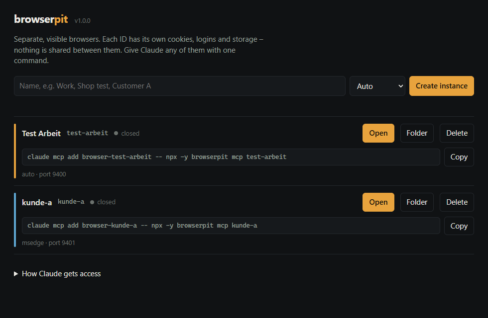

<h1 align="center">browserpit</h1>

<p align="center"><b>Separate, visible browsers with IDs – for you and for Claude.</b><br>
Every instance has its own cookies, logins, storage and cache. Give Claude any of them with one command.</p>

```bash
npx browserpit
```



## Why

- **Many accounts, no mixing.** `work`, `shop-test`, `customer-a` – each ID is its own browser profile folder. Nothing is shared: not cookies, not localStorage, not extensions, not sync.
- **Real windows, never headless.** You see what happens, log in yourself, solve 2FA and captchas yourself. Sites treat it like a normal browser.
- **Claude gets exactly the browser you choose.** Each instance is an MCP server (Playwright MCP over the DevTools protocol). Claude drives that window while you watch; several instances = several servers.
- **No account, no cloud.** Uses your installed Chrome or Edge (or Playwright's Chromium). Everything stays in `~/.browserpit`.

## Give Claude a browser

```bash
claude mcp add browser-work -- npx -y browserpit mcp work
claude mcp add browser-shop -- npx -y browserpit mcp shop
```

The instance is created on first use and its window opens when Claude connects. Log in once in that window – the login stays.

Claude Desktop / other MCP clients (`claude_desktop_config.json`):

```json
{ "mcpServers": { "browser-work": { "command": "npx", "args": ["-y", "browserpit", "mcp", "work"] } } }
```

Extra arguments after the ID go to Playwright MCP, e.g. `npx browserpit mcp work --caps vision`.

## Commands

```bash
npx browserpit                       # manager app (create, open, close, delete, copy the Claude command)
npx browserpit new "Customer A"      # → id customer-a  (--engine auto|chrome|msedge|chromium)
npx browserpit open customer-a [url]
npx browserpit close customer-a
npx browserpit list
npx browserpit delete customer-a     # removes the profile with all its data
npx browserpit mcp customer-a        # MCP server on stdio
```

Data folder: `~/.browserpit` (`BROWSERPIT_HOME` to change). Manager port 4319 (`--port`). Every instance keeps a fixed DevTools port from 9400 on, bound to `127.0.0.1` only.

## Security

The DevTools port gives full control over that browser – it only listens on `127.0.0.1`, but any program on your machine can reach it while the window is open. Close instances you don't need. Automated use of sites can violate their terms; you are responsible for what your agent does with your accounts.

## Many agents at once?

[agentpit](https://github.com/ManuelWestermeier/agentpit) is the full cockpit: many parallel Claude Code sessions, browser identities with live view from your phone, workflows, approvals. Its identities work in Claude Code too: `npx agentpit mcp <identity>`.

## License

MIT. Not affiliated with Anthropic. Claude is a trademark of Anthropic.
